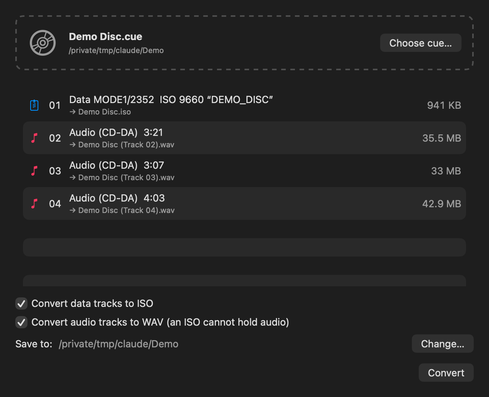
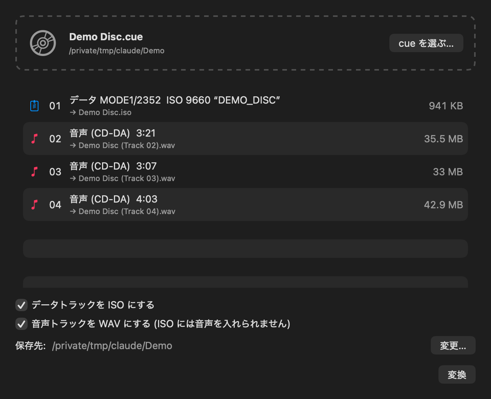

# UnBin

[English](#unbin) | [日本語](#unbin-日本語)

BIN/CUE Extractor for Mac — turns a CD image into data you can open (ISO) and music you can play (WAV).

A macOS GUI app that converts cue + bin CD images (a single bin or one bin per track) to ISO and WAV.
It has no external dependencies and is written entirely in Swift (SwiftUI).
The interface is in English or Japanese, following the system language.



- Data tracks → ISO (the 2048 bytes of user data are taken from each sector)
- Audio tracks (CD-DA) → WAV (44.1 kHz, 16-bit, stereo)

An ISO cannot hold audio tracks, so audio is written to files separate from the ISO.

UnBin is for looking inside a CD image (opening or mounting the ISO) and for extracting its music tracks.
It is not a tool for making an image that reproduces the original disc (keep using the original cue + bin for that).
The original image cannot be rebuilt from the ISO and WAV files, so do not throw the cue + bin away.
A bin holds raw 2352-byte sectors including sync patterns and error correction codes, so the ISO is smaller than the bin.

## Build

Requires the Xcode Command Line Tools (`swiftc`). macOS 13 or later, arm64 and Intel.

```sh
git clone https://github.com/fhiraki/UnBin.git
cd UnBin
bash build.sh
open build/UnBin.app
```

## Usage

1. Drop a `.cue` onto the window, or open one with "Choose cue…" (⌘O). Keep the bin files in the same folder as the cue.
   If you drop a bin, UnBin looks in the same folder for a cue that refers to it.
2. Check the track list (type, size, output file name). Click the note icon at the left of an audio track to preview it.
   Choose whether to write ISO and/or WAV, and where to save.
3. Press "Convert".

Output names come from the cue name: `<name>.iso` (`<name> (Track NN).iso` when there are several data tracks) and `<name> (Track NN).wav`.
If a file with the same name exists, UnBin asks before overwriting. It refuses to convert when an output would be one of the input files.
A file being written is named `.part` and gets its real name when it is complete.

The same conversion is available from the command line.

```sh
build/UnBin.app/Contents/MacOS/UnBin <cue> [output folder] [--no-iso] [--no-wav] [--no-align] [--force]
```

It stops without converting when an output file already exists. Pass `--force` to overwrite.

## Supported input

| Item | Support |
|---|---|
| Data | MODE1/2352, MODE1/2048, MODE2/2352, MODE2/2336 (for 2352 the mode is read from the sector header) |
| Audio | AUDIO and CDG (FILE type BINARY or MOTOROLA). Only the audio is extracted from CDG |
| Not supported | Cue sheets whose FILE is WAVE, MP3, etc.; saving subchannel data |

When something cannot go into an ISO or is lost, UnBin says so in the track list and after the conversion (on standard error from the command line):
audio-only discs (no ISO is written), tracks with Form 2 sectors such as Video CD (video and audio data is truncated),
sectors that fail the EDC (error detection code) check, sectors without a sync pattern, and images shorter than the volume size.
The list shows the filesystem type (ISO 9660, Joliet, Rock Ridge, El Torito, UDF, HFS, hybrid) and the volume name.
An ISO 9660 data track that starts in the middle of the disc (not at LBA 0), as on a CD Extra, is padded with an empty (sparse) area of the same length,
and a copy of the volume descriptors is placed at LBA 16, so that the ISO mounts as is (`--no-align` extracts just the track).
A multisession data CD, such as a CD-R written in several sessions, is combined into a single ISO.
Audio is cut from INDEX 01, so pregaps are left out; if there is hidden audio before the first track, it is written to `<name> (Track 00).wav`.
The specification and implementation status are in [docs/spec.md](docs/spec.md) (Japanese).

## Tests

```sh
python3 -I tests/test.py build/UnBin.app/Contents/MacOS/UnBin
```

This converts synthetic CD images (MODE1, MODE2, Form 2, 2336, several tracks in one bin, pregaps, MOTOROLA, CDG, audio only, CD Extra alignment, multisession, hidden track, EDC errors, filesystem detection, error cases) and compares the results.
With a real disc, the image of a commercial CD (MODE1/2352 data + 7 CD-DA tracks) was confirmed to match, byte for byte, an ISO and WAV files made by other means.
MODE2, MOTOROLA, CD Extra, multisession and hidden tracks have only been checked with synthetic images.

`python3 tests/mount_check.py build/UnBin.app/Contents/MacOS/UnBin` rearranges an ISO made with `hdiutil` into the shape of a CD Extra, converts it,
then temporarily mounts the aligned ISO on macOS and compares the files inside.

The window can be drawn to a PNG without showing it: `UnBin --snapshot <png> [cue] [running|done] [dark]`.
To rebuild the icon: `swiftc tools/make_icon.swift -o build/make_icon && build/make_icon build/AppIcon.iconset && iconutil -c icns build/AppIcon.iconset -o AppIcon.icns`.

## License

[MIT License](LICENSE)

---

# UnBin (日本語)

BIN/CUE Extractor for Mac — CD イメージを、開けるデータ (ISO) と聴ける音楽 (WAV) に取り出す。

cue + bin (bin が 1 本でも、トラックごとに分かれていても) の CD イメージを、macOS で ISO と WAV に変換する GUI アプリ。
外部の依存はなく、Swift (SwiftUI) だけで書いている。
画面はシステムの言語に合わせて、日本語か英語で表示する。



- データトラック → ISO (1 セクタ 2048 バイトの利用者データを取り出す)
- 音声トラック (CD-DA) → WAV (44.1kHz・16 ビット・ステレオ)

ISO は音声トラックを持てない形式なので、音声は ISO とは別のファイルになる。

用途は、CD イメージの中身を見ること (ISO を開く・マウントする) と、音楽トラックを取り出すこと。
元のディスクを再現するイメージを作る道具ではない (その用途には元の cue + bin をそのまま使う)。
ISO と WAV からは元のイメージに戻せないので、cue + bin は捨てずに残しておく。
bin は同期信号や誤り訂正符号を含む 1 セクタ 2352 バイトの生データなので、ISO は元の bin より小さくなる。

## ビルド

Xcode のコマンドラインツール (`swiftc`) が要る。macOS 13 以降、arm64 / Intel 両対応。

```sh
git clone https://github.com/fhiraki/UnBin.git
cd UnBin
bash build.sh
open build/UnBin.app
```

## 使い方

1. `.cue` を窓にドロップするか「cue を選ぶ…」(⌘O) で開く。bin は cue と同じフォルダに置く。
   bin をドロップしたときは、同じフォルダからその bin を指す cue を探す。
2. トラックの一覧 (種類・大きさ・出力ファイル名) を確かめ、音声トラックは左端の音符を押すと試聴できる。
   ISO / WAV のどちらを書き出すかと保存先を選ぶ。
3. 「変換」を押す。

出力ファイル名は cue の名前から作る: `<名前>.iso` (データトラックが複数なら `<名前> (Track NN).iso`)、`<名前> (Track NN).wav`。
同じ名前のファイルがあれば上書きの前に確かめ、出力が入力のファイルと重なる場合は変換しない。
書いている途中のファイルは `.part` という名前で、終わると正しい名前になる。

コマンドラインでも同じ変換ができる。

```sh
build/UnBin.app/Contents/MacOS/UnBin <cue> [出力先] [--no-iso] [--no-wav] [--no-align] [--force]
```

同じ名前のファイルがあると変換せずに終わる。上書きするときは `--force` を付ける。

## 対応範囲

| 項目 | 対応 |
|---|---|
| データ | MODE1/2352・MODE1/2048・MODE2/2352・MODE2/2336 (2352 はセクタのヘッダからモードを判定) |
| 音声 | AUDIO・CDG (FILE が BINARY または MOTOROLA)。CDG は音声だけを取り出す |
| 非対応 | FILE が WAVE・MP3 などの cue、サブチャンネルの保存 |

ISO にできない・欠ける内容があるときは、一覧と変換後の表示 (コマンドラインでは標準エラー) で知らせる:
音声だけのディスク (ISO は作らない)、Video CD のようなフォーム 2 のセクタを含むトラック (動画・音声が欠ける)、
EDC (誤り検出符号) の合わないセクタ、同期信号の無いセクタ、ボリュームの大きさに足りないイメージ。
一覧にはファイルシステムの種類 (ISO 9660・Joliet・Rock Ridge・El Torito・UDF・HFS・ハイブリッド) とボリューム名を出す。
CD Extra のようにディスクの途中 (LBA 0 以外) から始まる ISO 9660 のデータトラックは、先頭に同じ長さの空き (スパース) を入れ、
ボリューム記述子の写しを LBA 16 に置いて、そのままマウントできる ISO にする (`--no-align` でトラックだけの取り出しにできる)。
追記した CD-R のようなマルチセッションのデータ CD は、全セッションを 1 本の ISO にまとめる。
音声は INDEX 01 から切り出すのでプリギャップは入らないが、1 曲目の前に隠れた音 (隠しトラック) があれば `<名前> (Track 00).wav` に書き出す。
仕様と実装の状態は [docs/spec.md](docs/spec.md)。

## 試験

```sh
python3 -I tests/test.py build/UnBin.app/Contents/MacOS/UnBin
```

合成した CD イメージ (MODE1・MODE2・フォーム 2・2336・単一 bin に複数トラック・プリギャップ・MOTOROLA・CDG・音声のみ・CD Extra の位置合わせ・マルチセッション・隠しトラック・EDC の誤り・ファイルシステムの判別・異常系) を変換して結果を比べる。
実物では、MODE1/2352 のデータ + CD-DA 7 トラックの市販 CD のイメージが、別の手段で作った ISO・WAV とバイト単位で一致することを確かめた。
MODE2・MOTOROLA・CD Extra・マルチセッション・隠しトラックは合成イメージでしか確かめていない。

`python3 tests/mount_check.py build/UnBin.app/Contents/MacOS/UnBin` は、`hdiutil` で作った ISO を CD Extra の形に組み直して変換し、
位置合わせした ISO を macOS で一時的にマウントして中のファイルを照合する。

画面は `UnBin --snapshot <png> [cue] [running|done] [dark]` で、窓を出さずに PNG に描ける。
アイコンは `swiftc tools/make_icon.swift -o build/make_icon && build/make_icon build/AppIcon.iconset && iconutil -c icns build/AppIcon.iconset -o AppIcon.icns` で作り直す。

## ライセンス

[MIT License](LICENSE)
